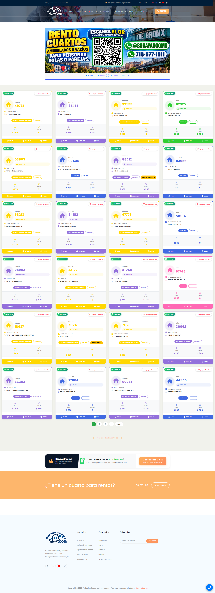
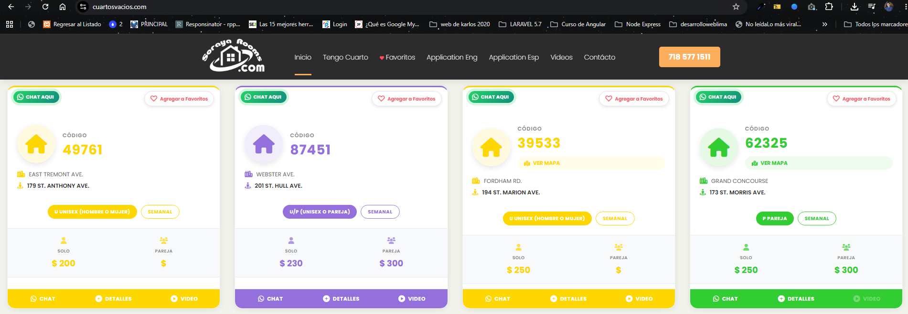
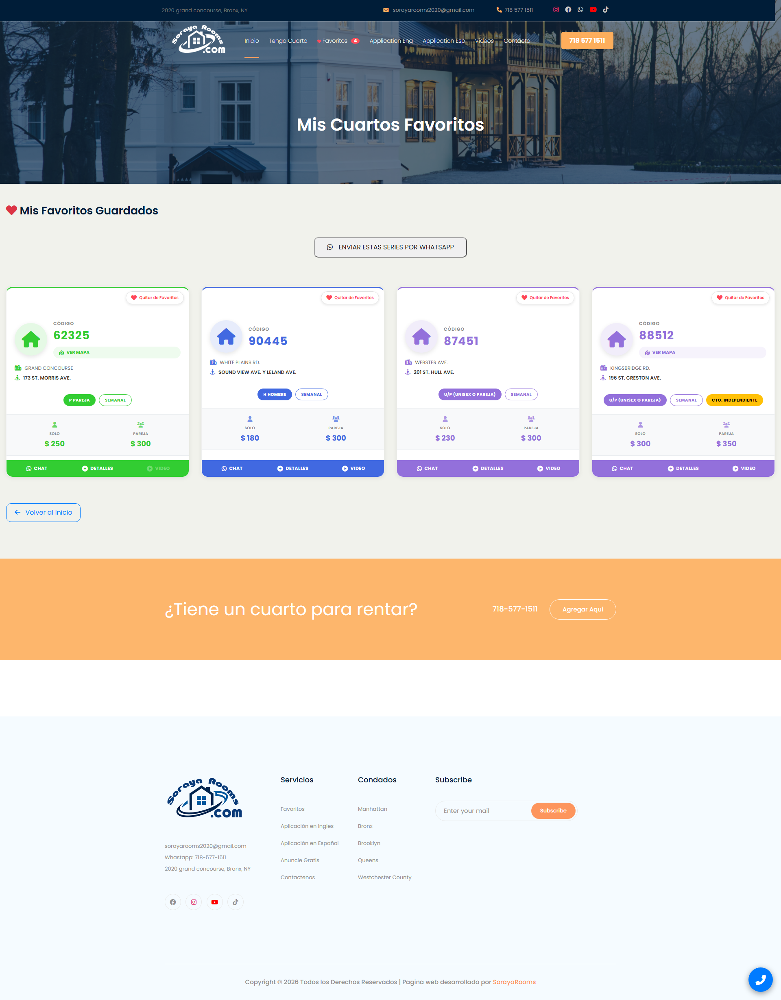
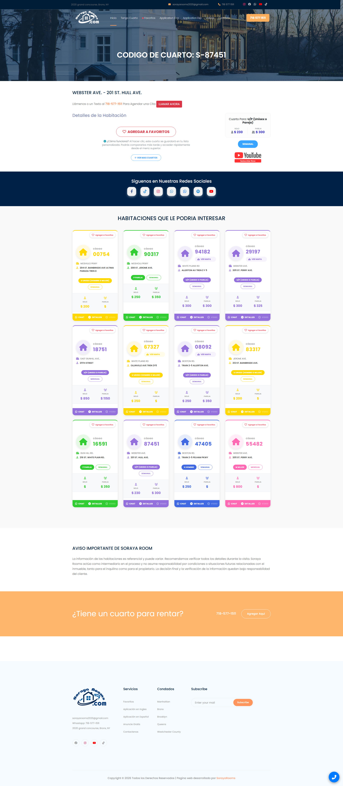
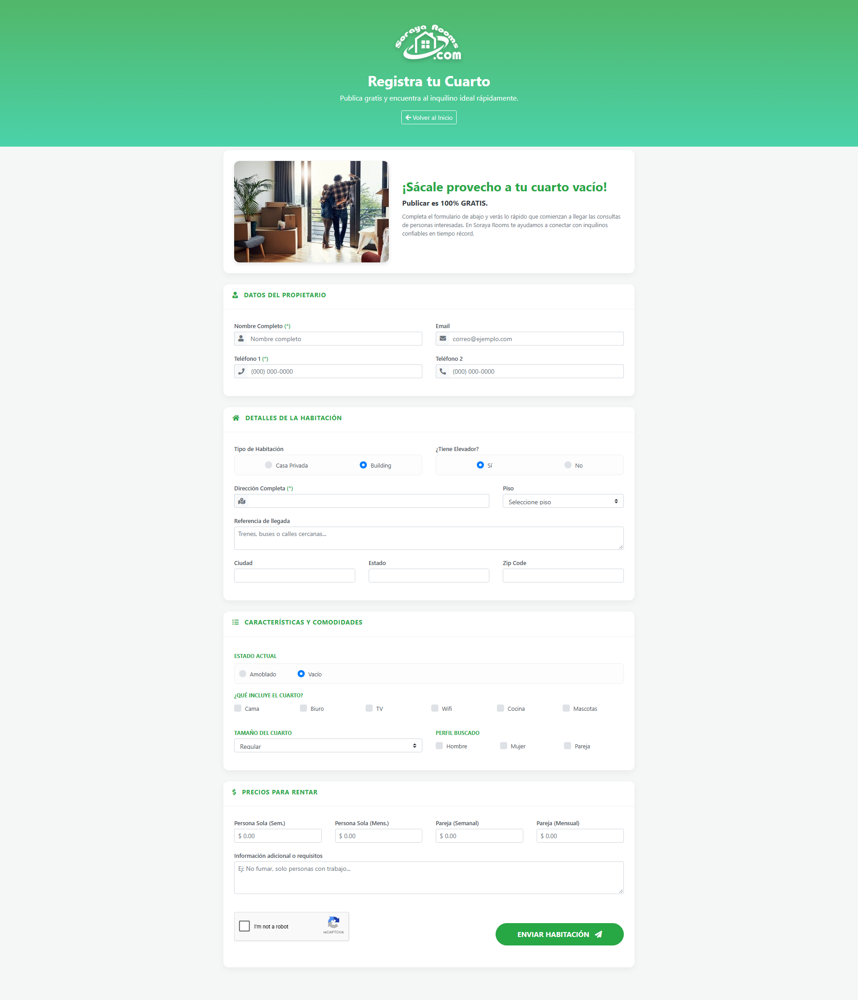
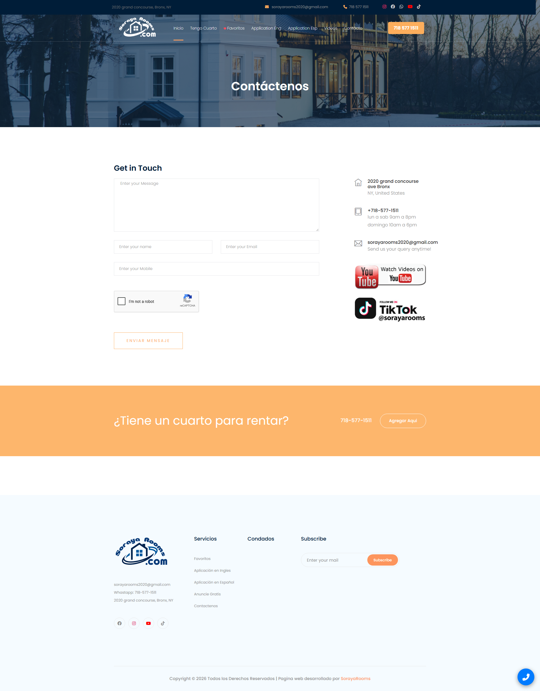
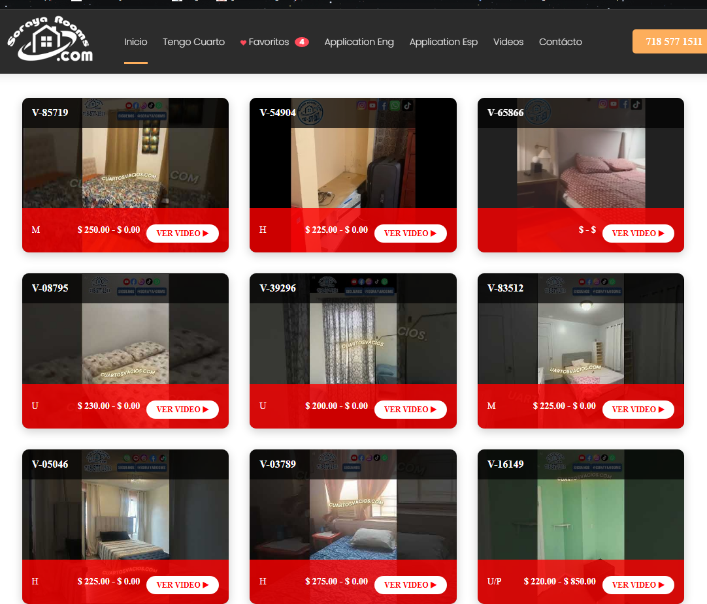
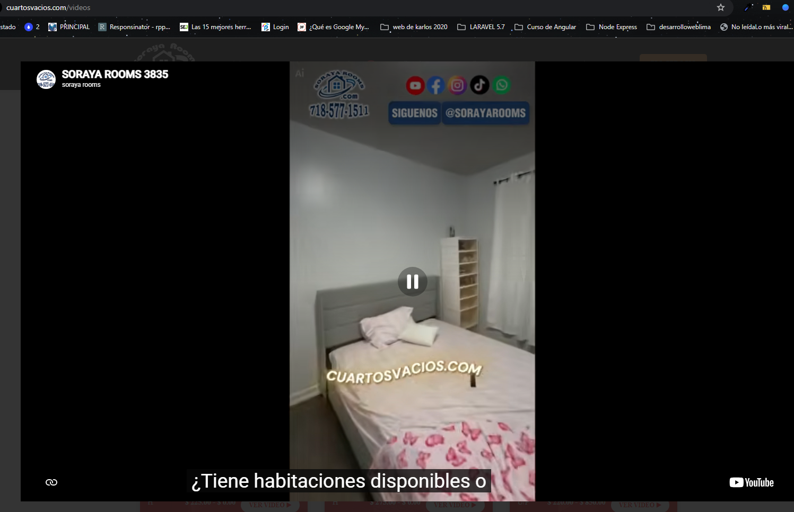

# 🏠 CuartosVacios.com
### Plataforma web para alquiler de habitaciones en New York, USA

<p align="center">
  <strong>Encuentra tu espacio ideal en Bronx, Manhattan y Yonkers.</strong>
</p>

<p align="center">
  <a href="https://www.cuartosvacios.com">Sitio web oficial</a> ·
  <a href="https://github.com/karlosystem/cuartosvacios">Repositorio GitHub</a>
</p>

---

## 📌 Descripción del proyecto

**CuartosVacios.com** es una plataforma web orientada a la publicación, búsqueda y alquiler de habitaciones en el área de New York, Estados Unidos, principalmente en los distritos de **Bronx, Manhattan y Yonkers**.

El portal está dirigido a personas que buscan habitaciones para una persona o parejas, ofreciendo información sobre disponibilidad, ubicación, precios, características y servicios de cada alojamiento.

El proyecto cuenta con un backend desarrollado y un frontend en proceso de rediseño, enfocado en mejorar la experiencia de navegación, la presentación de las habitaciones y el posicionamiento orgánico en los motores de búsqueda.

### Objetivos principales

- Facilitar la búsqueda de habitaciones disponibles.
- Presentar información clara sobre precios, ubicación y características.
- Mejorar la experiencia de usuario en dispositivos móviles y escritorio.
- Facilitar el contacto entre interesados y administradores mediante WhatsApp.
- Optimizar la estructura frontend para mejorar el SEO orgánico.
- Mantener una arquitectura compatible con la infraestructura tecnológica existente.

---

## 🖥️ Tecnologías utilizadas

| Tecnología | Versión / Implementación | Función |
|---|---|---|
| PHP | 5.4 | Lenguaje de programación backend |
| CodeIgniter | 3.1.11 | Framework MVC |
| MySQL | Según servidor | Gestión de información |
| Bootstrap | 4.0.0 | Diseño responsive |
| HTML5 | — | Estructura de las vistas |
| CSS3 | — | Estilos y presentación visual |
| JavaScript | — | Interactividad del frontend |
| jQuery | Según implementación | Manipulación del DOM y AJAX |
| Git | — | Control de versiones |
| GitHub | — | Repositorio y respaldo del proyecto |

---

## 🏗️ Arquitectura del proyecto

La aplicación utiliza el patrón de arquitectura **MVC (Modelo - Vista - Controlador)** proporcionado por CodeIgniter 3.

- **Model:** acceso y gestión de información almacenada en MySQL.
- **View:** presentación de contenidos y componentes visuales.
- **Controller:** procesamiento de solicitudes y coordinación entre modelos y vistas.

### Estructura principal

```text
cuartosvacios/
│
├── application/
│   ├── config/
│   ├── controllers/
│   ├── core/
│   ├── helpers/
│   ├── hooks/
│   ├── libraries/
│   ├── models/
│   └── views/
│
├── assets/
│   ├── css/
│   ├── images/
│   ├── img/
│   ├── js/
│   └── fonts/
│
├── img/
├── js/
├── system/
├── templetes/
│
├── .gitignore
├── .htaccess
└── index.php
```

> La estructura corresponde a la organización del proyecto. Algunos directorios pueden contener recursos adicionales según la implementación existente.

---

## 🎨 Diseño del frontend

El rediseño de CuartosVacios.com busca ofrecer una interfaz moderna, intuitiva y adaptable a diferentes dispositivos, manteniendo la compatibilidad con el backend existente.

### Componentes principales

- **Header:** identidad visual, navegación principal y acceso telefónico.
- **Hero principal:** presentación del servicio y buscador de habitaciones.
- **Accesos geográficos:** navegación por Bronx, Manhattan y Yonkers.
- **Habitaciones disponibles:** tarjetas informativas con fotografías, códigos, precios, ubicación y características.
- **Acciones de contacto:** acceso a detalles, WhatsApp y videos cuando estén disponibles.
- **Cómo rentar:** explicación visual del proceso de alquiler en tres pasos.
- **Beneficios:** habitaciones verificadas, zonas de atención, precios y atención personalizada.
- **Footer:** información corporativa, navegación, contacto y redes sociales.

---

## 🖥️ Galería del proyecto

Conoce las principales interfaces y funcionalidades de **CuartosVacios.com – Soraya Rooms**, plataforma web orientada a la publicación, búsqueda y alquiler de habitaciones en New York, USA.

### 🏠 Página principal

Vista general del portal, encabezado de navegación y slider promocional.




### 🛏️ Habitaciones disponibles

Presentación de las habitaciones, información de precios, ubicación y opciones de consulta.



### ❤️ Habitaciones favoritas

Interfaz para consultar las habitaciones guardadas por los usuarios.



### 📋 Detalle de habitación

Visualización de la información y características de una habitación seleccionada.



### 📝 Registro de habitaciones

Formulario para registrar habitaciones disponibles en la plataforma.



### 📩 Contacto y comunicación

Formulario de contacto y herramientas de comunicación con los usuarios.




### 🎥 Videos de habitaciones

Listado de videos y vista previa de contenido audiovisual integrado con YouTube.





---

### Diseño responsive

La interfaz utiliza Bootstrap 4.0.0 y CSS personalizado para adaptar sus componentes a:

- Computadoras de escritorio.
- Laptops.
- Tablets.
- Dispositivos móviles.

---

## 🔎 Estrategia de SEO

El rediseño contempla mejoras orientadas al posicionamiento orgánico y a la indexación del contenido por los principales motores de búsqueda.

Líneas de trabajo:

- Optimización de títulos SEO (`title`).
- Meta descripciones relevantes.
- Jerarquía semántica de encabezados HTML.
- URLs amigables por ubicación y contenido.
- Optimización de imágenes y atributos `alt`.
- Enlaces internos entre páginas y zonas geográficas.
- Implementación y revisión de sitemap XML.
- Configuración de etiquetas canonical.
- Datos estructurados cuando correspondan.
- Optimización de rendimiento y experiencia móvil.
- Integración y seguimiento mediante Google Search Console.

---

## ⚙️ Entorno de desarrollo

El proyecto puede trabajarse localmente utilizando un entorno compatible con PHP 5.4 y MySQL.

### Requisitos

- Servidor web Apache.
- PHP 5.4.
- MySQL compatible con la configuración existente.
- Extensiones PHP requeridas por CodeIgniter 3.
- Visual Studio Code (recomendado).
- Git.

### Instalación local

1. Clonar el repositorio:

```bash
git clone https://github.com/karlosystem/cuartosvacios.git
```

2. Ubicar el proyecto dentro del directorio de publicación de Apache.

3. Configurar la conexión a MySQL en:

```text
application/config/database.php
```

4. Revisar la configuración general de CodeIgniter:

```text
application/config/config.php
```

5. Configurar localmente las credenciales de los servicios externos utilizados por la aplicación, cuando corresponda.

6. Configurar Apache y el acceso local al proyecto.

7. Abrir la aplicación desde el navegador.

**Importante:** las configuraciones privadas y credenciales no forman parte del repositorio. Deben prepararse localmente antes de ejecutar la aplicación.

---

## 🔐 Seguridad y buenas prácticas

El repositorio utiliza `.gitignore` para evitar publicar archivos que contienen configuraciones privadas.

Se excluyen, entre otros:

- Credenciales de conexión a MySQL.
- Configuraciones privadas de CodeIgniter.
- Claves de servicios externos.
- Archivos temporales y logs.
- Respaldos de bases de datos.

No almacenar contraseñas, tokens, claves API ni información sensible en el repositorio.

---

## 🌿 Control de versiones

El proyecto utiliza Git y GitHub para mantener un historial de cambios y respaldos del código fuente.

**Repositorio:**

```text
https://github.com/karlosystem/cuartosvacios
```

**Rama principal:**

```text
main
```

### Flujo de trabajo

```bash
# Revisar cambios
git status

# Preparar archivos
git add .

# Crear commit
git commit -m "Descripción de los cambios"

# Sincronizar con GitHub
git push origin main
```

Se recomienda realizar commits descriptivos por cada mejora o fase de desarrollo.

---

## 🚀 Mejoras y evolución del proyecto

El desarrollo contempla una evolución progresiva del portal, priorizando:

1. Rediseño y optimización de la interfaz frontend.
2. Mejora de la presentación de habitaciones.
3. Optimización de navegación y experiencia móvil.
4. Mejoras de SEO técnico y contenido.
5. Optimización de rendimiento.
6. Revisión de accesibilidad y usabilidad.
7. Seguimiento del posicionamiento orgánico.

---

## 📍 Información del proyecto

| Información | Detalle |
|---|---|
| Nombre | CuartosVacios.com |
| Marca comercial | Soraya Rooms |
| Sitio web | https://www.cuartosvacios.com |
| Ubicación | Bronx, New York, USA |
| Áreas de atención | Bronx, Manhattan y Yonkers |
| Público objetivo | Personas solas y parejas |
| Arquitectura | MVC |
| Backend | PHP 5.4 / CodeIgniter 3 |
| Base de datos | MySQL |
| Frontend | Bootstrap 4.0.0 |
| Repositorio | GitHub privado |

---

<p align="center">
  <strong>CuartosVacios.com · Soraya Rooms</strong><br>
  <em>Más que una habitación, tu nuevo hogar.</em>
</p>

<p align="center">
  © 2026 CuartosVacios.com. Todos los derechos reservados.
</p>
